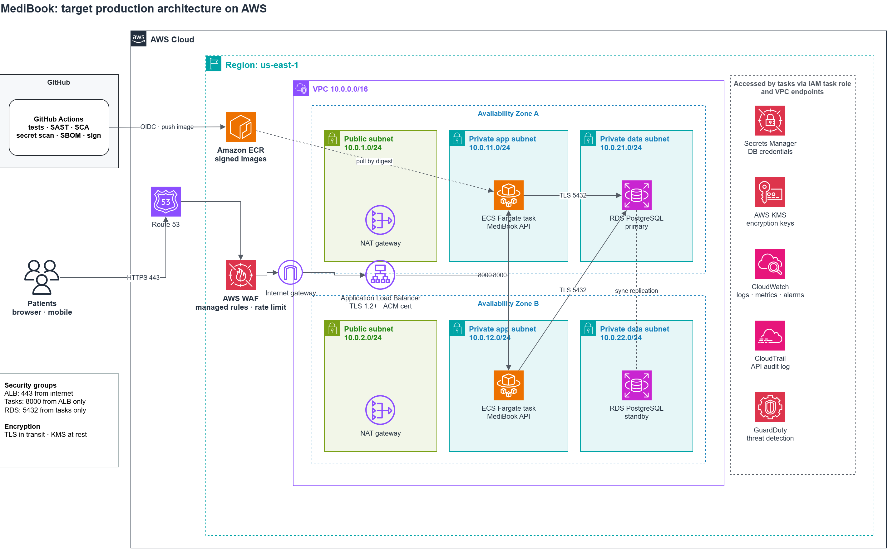

# MediBook

[](https://github.com/abdurahim50/medibook/actions/workflows/ci.yml)
[](https://github.com/abdurahim50/medibook/actions/workflows/release.yml)
[](docs/brief.md#assumptions)

Appointment booking API for outpatient clinics. Patients create an account, browse open appointment slots, book a visit and view their own bookings.

The current release provides the patient booking API. Staff tools and an AI-assisted intake flow are planned for future releases.

> **Data notice:** this environment runs on synthetic data only. It holds no real patient information and is not intended for clinical use.

Latest verified deployment: [round 6, 2026-10-14](docs/evidence/deployment/aws-verification-2026-10-14-round6.md). All 145 local tests and all 12 PR checks passed; the approved migration, API readiness, alert delivery, outage detection and recovery were verified. The dev deployment was removed after the session. CI and Release badges show workflow status on `main`, not whether an AWS service is running.

## Why I Built This

I built MediBook as a CyberAgoge portfolio project to practise securing an application through its full delivery cycle. Appointment booking gave me concrete problems to solve: keeping each patient's bookings private, preventing double booking, and recovering when a dependency fails.

My goal was to connect application security, cloud infrastructure and operations in one project, with tests and deployment evidence I could explain. All patient data is synthetic, and the project is a learning environment.

## Patient workflow

1. Create a patient account.
2. Sign in to receive an access token.
3. Browse open appointment slots.
4. Book a slot.
5. View the appointments linked to your account.

## Features

- Patient registration, sign-in and sign-out
- Server-side sessions with an 8-hour expiry and immediate revocation on sign-out
- Open, upcoming appointment slots across clinics, ordered by time; past slots cannot be booked
- Booking with database-enforced protection against double booking
- Patient-specific appointment list
- Strict request validation and consistent HTTP errors
- Throttling of repeated failed sign-ins
- Structured JSON audit log of security events
- Security headers on every response (no caching, no MIME sniffing, no framing, same-origin only)
- Liveness (`/health`) and readiness (`/ready`) endpoints, and interactive API documentation at `/docs`

## Architecture



Target production architecture on AWS. Edit `diagrams/architecture.drawio.png` in VS Code with the Draw.io Integration extension, or at [app.diagrams.net](https://app.diagrams.net).

| Layer | Design |
| --- | --- |
| Edge | Route 53 DNS, AWS WAF (managed rules, rate limiting), Application Load Balancer terminating TLS 1.2+ |
| Compute | ECS Fargate tasks in private subnets across two Availability Zones; non-root containers with read-only filesystems |
| Data | Amazon RDS PostgreSQL, Multi-AZ, KMS-encrypted, automated backups; reachable only from the app tier |
| Secrets | The API signs in to the database with short-lived RDS IAM tokens through its task role; the admin password, generated by RDS in Secrets Manager, is used only for migrations |
| Delivery | GitHub Actions runs tests and security scans, then signs and publishes images through OIDC; workstation Terraform verifies and deploys the image digest; a protected GitHub workflow runs migrations |
| Operations | CloudWatch logs, metrics and alarms; CloudTrail and GuardDuty for audit and threat detection |

The dev deployment is a cost-reduced slice of this design: see [docs/deployment.md](docs/deployment.md). **[Implemented architecture and deployment flow](docs/architecture.md)** contains the existing Mermaid delivery and request diagrams, plus a comparison of the dev environment and production target. Remaining gaps are on the [roadmap](#roadmap).

### Application stack

| Component | Technology | Responsibility |
| --- | --- | --- |
| API | Python 3.14, FastAPI, Uvicorn | HTTP routes, authentication dependency, booking operations |
| Validation | Pydantic | Request types, field constraints, rejection of unexpected fields |
| Data store | PostgreSQL 17: Amazon RDS in AWS, a container locally and in CI (`psycopg` 3, libpq from Debian) | Patients, sessions, slots and appointments; timestamps in UTC; the API's own role has row access only |
| AWS SDK | `boto3` | Signs RDS IAM authentication tokens in AWS (not used locally) |
| Password hashing | argon2id (`argon2-cffi`) | Memory-hard hashing with a per-password salt |
| Sessions | Opaque bearer tokens | Random 256-bit tokens; only a SHA-256 digest is stored |
| Tests | pytest, FastAPI TestClient, PostgreSQL | Tables recreated for every test in a dedicated `*_test` database |
| Container | Docker, `python:3.14-slim` pinned by digest | Multi-stage image, non-root user, read-only root filesystem |
| CI | GitHub Actions | Tests, SAST, dependency, secret and image scans, policy tests and an authenticated OWASP ZAP scan on every pull request |
| Release | GitHub Actions, GitHub OIDC, Syft, Cosign | Builds and pushes the image to ECR without stored AWS keys; CycloneDX SBOM; keyless signature and SBOM attestation |

### Technologies used

**Application**

[](#application-stack)
[](#application-stack)
[](#application-stack)
[](Dockerfile)

**AWS and infrastructure**

[](docs/deployment.md)
[](infra/ecs.tf)
[](infra/database.tf)
[](infra/)
[](infra/waf.tf)

**Delivery and security**

[](.github/workflows/ci.yml)
[](.github/workflows/release.yml)
[](#continuous-integration)
[](#continuous-integration)
[](#continuous-integration)
[](#release)
[](policy/README.md)
[](scripts/dast-scan.sh)

These badges identify technologies used in the project. The CI and Release badges at the top report workflow status.

See the [product brief](docs/brief.md) for users, protected data and scope.

Security controls are mapped to NIST SP 800-53 Rev. 5, with evidence and known gaps, in [docs/controls.md](docs/controls.md).

## Getting started

**Prerequisites:** Git, Docker, Python 3.14 with `venv`, and the PostgreSQL client library (`sudo apt install libpq5`). Commands target Ubuntu or Ubuntu on WSL2.

```bash
# Clone the repository
git clone https://github.com/abdurahim50/medibook.git
cd medibook

# Create and activate a virtual environment
python3 -m venv .venv
source .venv/bin/activate

# Install pinned application and test dependencies
python -m pip install --require-hashes -r requirements-dev.txt

# Start a local PostgreSQL with a development and a test database
# (same image and digest as CI and scripts/dast-scan.sh)
export PGPASSWORD="$(openssl rand -hex 16)"   # local only; lost when the shell closes
docker run -d --name medibook-db -p 127.0.0.1:5432:5432 \
  -e POSTGRES_USER=medibook -e POSTGRES_DB=medibook -e POSTGRES_PASSWORD="$PGPASSWORD" \
  postgres:17-alpine@sha256:b0f9560a2de083e2cc7382e75f808c7381a32852a7ec49117deedb300e552b24
# -h 127.0.0.1: wait for the TCP listener, not the temporary init server on the Unix socket
for _ in $(seq 1 30); do docker exec medibook-db pg_isready -h 127.0.0.1 -U medibook -d medibook >/dev/null 2>&1 && break; sleep 1; done
docker exec medibook-db pg_isready -h 127.0.0.1 -U medibook -d medibook   # fails here if PostgreSQL did not start in 30 s
docker exec medibook-db createdb -U medibook medibook_test

# Point the app at it (standard libpq variables)
export PGHOST=127.0.0.1 PGPORT=5432 PGUSER=medibook PGDATABASE=medibook
export PGSSLMODE=disable MEDIBOOK_DB_IAM_AUTH=0   # disposable local database only

# Choose a demo password, then create the tables and load demo accounts and slots
export MEDIBOOK_SEED_PASSWORD="$(openssl rand -base64 18)"
python -m app.seed

# Start the API on localhost:8000
python -m uvicorn app.main:app --host 127.0.0.1 --port 8000
```

The database is published on `127.0.0.1` only, so it is not reachable from your network. The seed command creates the schema, two demo patients and ten open slots across two clinics; the API itself never changes the schema. The demo accounts share the password in `MEDIBOOK_SEED_PASSWORD`; the seed command refuses to run without it and never prints it.

| Demo account |
| --- |
| `alex.rivera@example.com` |
| `sam.taylor@example.com` |

**Verify the service** from another terminal:

```bash
curl -sS http://127.0.0.1:8000/health
# {"status":"ok"}
curl -sS http://127.0.0.1:8000/ready
# {"status":"ok"}  (503 {"status":"unavailable"} if the database is unreachable)
```

**Try the API** at <http://127.0.0.1:8000/docs>: call `POST /auth/signin`, copy the `access_token`, then click **Authorize** and paste it to use protected endpoints.

Stop the server with `Ctrl+C`, and the database with `docker stop medibook-db`.

### Run with Docker

`scripts/dast-scan.sh` shows the full container setup: the API image with a read-only root filesystem, no Linux capabilities and `no-new-privileges`, next to a PostgreSQL container on a private Docker network. The container runs as an unprivileged user (UID 10001) and keeps no data: everything is in PostgreSQL.

## Deploy to AWS

Infrastructure is split into stacks with different lifecycles:

| Stack | Path | Contents |
| --- | --- | --- |
| Account baseline | separate repository `aws-account-baseline` | GitHub Actions OIDC identity provider, shared by all projects |
| Bootstrap | [`infra/bootstrap/`](infra/bootstrap/) | ECR repository and the release, read-only plan and approval-gated migration roles |
| Environment | [`infra/`](infra/) | VPC, Application Load Balancer, AWS WAF, ECS Fargate (API service and a one-off migration task), RDS PostgreSQL, CloudWatch alarms; created and destroyed each session |

Images are deployed by digest. A fresh session prepares the task definitions with zero API tasks, runs the approved migration through `migrate-dev-v2`, and starts the API only after the migration exits successfully. Terraform verifies each image's signature and SBOM attestation during the plan and refuses images not signed by the release workflow on `main`. Every saved Terraform plan is checked with `scripts/policy-check.sh` before apply, including rollback and teardown. See [docs/deployment.md](docs/deployment.md) for cost, setup, deployment and teardown, and [docs/runbook.md](docs/runbook.md) for alarm response.

## API reference

Protected endpoints require `Authorization: Bearer <access_token>`.

| Method | Path | Description | Auth | Success |
| --- | --- | --- | --- | --- |
| `GET` | `/health` | Liveness: the API process is up (no database check); used by the load balancer | None | `200` |
| `GET` | `/ready` | Readiness: the API can reach the database | None | `200`, or `503` |
| `POST` | `/auth/signup` | Register a patient | None | `201` |
| `POST` | `/auth/signin` | Sign in and receive a session token | None | `200` |
| `POST` | `/auth/signout` | Revoke the current session | Required | `204` |
| `GET` | `/slots` | List open appointment slots | Required | `200` |
| `POST` | `/appointments` | Book a slot | Required | `201` |
| `GET` | `/appointments` | List the signed-in patient's appointments | Required | `200` |
| `GET` | `/appointments/{appointment_id}` | Get one of the signed-in patient's appointments | Required | `200` |

**Booking request:**

```json
{ "slot_id": 1 }
```

`slot_id` must be a positive integer. Patient identity always comes from the session; unknown fields, including a client-supplied `patient_id`, are rejected.

**Errors:** `401` invalid or missing authentication, `404` record not found or owned by another patient, `409` email already registered or slot already booked, `422` invalid request data, `429` too many failed sign-in attempts (see `Retry-After`), and `503` for database connection failures (`Service temporarily unavailable`, `Retry-After: 60`). `/ready` uses its own `503` response, `{"status":"unavailable"}`. Unexpected programming errors remain server errors.

## Configuration

| Variable | Default | Description |
| --- | --- | --- |
| `PGHOST`, `PGPORT`, `PGDATABASE`, `PGUSER`, `PGPASSWORD` | libpq defaults | PostgreSQL connection ([libpq environment variables](https://www.postgresql.org/docs/current/libpq-envars.html)) |
| `PGSSLMODE`, `PGSSLROOTCERT` | libpq defaults | TLS to the database; local examples disable TLS for the disposable loopback database only; AWS requires `verify-full` with the RDS CA bundle |
| `MEDIBOOK_SEED_PASSWORD` | None (required by the seed command) | Password assigned to the demo accounts |
| `MEDIBOOK_APP_DB_USER` | None | Seed command only: create this least-privilege role for the API and grant it row access (used in AWS) |
| `MEDIBOOK_DB_IAM_AUTH` | Off | `1`: sign in with an RDS IAM token for `PGUSER` instead of `PGPASSWORD` (needs `AWS_REGION` and AWS credentials; used in AWS) |
| `MEDIBOOK_READINESS_PROBE_SECONDS` | `60` | Fixed interval for the background database probe; `0` disables it and removes idle-outage coverage |
| `MEDIBOOK_READINESS_GRACE_UNTIL` | Unset | Exceptional bootstrap only: ISO 8601 UTC deadline at most 15 minutes ahead; it does not renew on restart and ends early on first success |
| `MEDIBOOK_READINESS_GRACE_SECONDS` | `0` | Legacy setting; nonzero values are rejected. Normal startup has no quiet period |

Set these in your shell before running the seed command or server. The application does not load `.env` files automatically; `.env.example` lists every supported variable. Never commit a `.env` file or a password.

### Dependencies

Direct dependencies are listed in [`requirements.in`](requirements.in) (runtime) and [`requirements-dev.in`](requirements-dev.in) (tests). The installable files, `requirements.txt` and `requirements-dev.txt`, are lock files generated by [pip-tools](https://pip-tools.readthedocs.io/): every package, including indirect ones, is pinned with its SHA-256 hashes, so pip refuses a file that does not match. To change a dependency, edit the `.in` file, then regenerate both locks with Python 3.14:

```bash
python -m pip install pip-tools
pip-compile --generate-hashes --strip-extras requirements.in
pip-compile --generate-hashes --strip-extras requirements-dev.in
```

Dependabot updates the `.in` files and the locks together.

### Resetting the development database

Seeding a database that already has slots leaves it unchanged. To rebuild a disposable development database, stop the server, then run:

```bash
python -m app.seed --reset
```

This drops all MediBook tables in the database `PGDATABASE` points at, permanently deleting all accounts, sessions and bookings. Check `echo $PGDATABASE` first.

## Testing

```bash
# Activate the project's Python environment.
source .venv/bin/activate

# Run the tests against the test database; -q requests concise output.
PGDATABASE=medibook_test python -m pytest -q
```

Use the same shell and PostgreSQL settings from Getting started; set `PGDATABASE=medibook_test` for the tests. Tests use real PostgreSQL. The fixtures drop and recreate tables, so [`tests/conftest.py`](tests/conftest.py) refuses a database whose name does not end in `_test`. The suite covers the patient journey, ownership, concurrent booking, validation, audit logging, throttling, headers, UTC timestamps, the API database role's limits, and RDS IAM tokens. Round 6 added controlled database-error responses, default-zero and fixed-deadline readiness behavior, and migration guard checks. [Recorded result](docs/evidence/deployment/aws-verification-2026-10-14-round6.md): 145 passed on Python 3.14 with PostgreSQL.

### Continuous integration

Every pull request and push to `main` runs [`.github/workflows/ci.yml`](.github/workflows/ci.yml):

| Check | Tool | Fails when |
| --- | --- | --- |
| Tests | pytest, PostgreSQL service container | Any test fails |
| SAST | Bandit, Semgrep (`p/python`, `p/owasp-top-ten`) | Bandit reports a medium or higher severity issue, or Semgrep reports any finding |
| Dependency scan | pip-audit | A pinned package has a known vulnerability or cannot be checked |
| Secret scan | gitleaks | A secret is found anywhere in the git history |
| Image scan | Trivy | The Dockerfile has a HIGH or CRITICAL misconfiguration, or the image has a fixable HIGH or CRITICAL vulnerability |
| Policy tests | Conftest | A policy unit test fails, or the known-bad Terraform plan is not blocked by every rule |
| DAST | OWASP ZAP | An authenticated API scan of the running container raises an alert not accepted in [`.zap/rules.tsv`](.zap/rules.tsv), or the scan loses its session |
| Terraform plan | Terraform, Cosign, Conftest | Either stack is unformatted or invalid, the latest release image fails signature verification, or a real plan of either stack violates a policy |

The workflow has read-only repository permissions, actions are pinned by commit SHA, and scanner binaries and images are pinned by checksum or digest. Changes to protected `main` arrive through pull requests with required CI checks and DCO sign-off. PR #46 completed 12 successful checks, including the eight CI jobs, DCO and GitHub's CodeQL checks. Within CI, only the Terraform plan job receives an AWS identity: it can read the image repository, availability-zone metadata and the GitHub OIDC provider, with no write actions or access to Terraform state.

### Release

Every merge to `main` that changes more than documentation runs [`.github/workflows/release.yml`](.github/workflows/release.yml): build, Trivy gate, push to ECR by digest through GitHub OIDC (no stored AWS keys), CycloneDX SBOM with Syft, and a keyless Cosign signature and SBOM attestation, which the workflow verifies before finishing. The run summary shows the digest to deploy.

### Contributing

Create a branch, keep the change scoped, run the relevant checks and open a pull request into `main`. Use both a DCO sign-off and a cryptographic signature when committing:

```bash
git commit -s -S -m "docs: update deployment evidence"
```

Lowercase `-s` adds the `Signed-off-by` trailer required by DCO. Uppercase `-S` signs the commit using your configured signing key; GitHub verification requires that key to be registered for signing. Use the evidence index for dated results and the current guides for operating instructions.

## Project structure

```
Dockerfile     container image definition
requirements.in      direct runtime dependencies
requirements-dev.in  direct test dependencies
requirements*.txt    generated lock files with hashes (pip-compile)
infra/         Terraform for the AWS dev environment
  bootstrap/   ECR repository and release, plan and migration roles (long-lived)
.github/workflows/
  ci.yml       tests and security scans on every pull request
  release.yml  build, sign and publish the image on main
  migrate.yml  approved database migration on main in migrate-dev-v2
policy/
  terraform/   Conftest policies and their unit tests
  fixtures/    compliant and non-compliant sample plans
scripts/
  verify-image.sh  verify an image signature before deploying
  verify-image-terraform.sh  signature check run by Terraform during plan
  policy-check.sh  check a Terraform plan before applying
  dast-scan.sh     authenticated OWASP ZAP scan
  check-migrate-environment.sh  validate migration protection rules and workflow revision
  check-alerting.sh  verify a confirmed subscription and publish a delivery test
.zap/rules.tsv     accepted ZAP alerts (none)
app/
  main.py      API routes and session dependency
  auth.py      password hashing and session management
  audit.py     structured audit log
  ratelimit.py failed sign-in throttling
  db.py        PostgreSQL connection, IAM token sign-in, schema and grants
  models.py    request and response models
  seed.py      migration: schema, API role and grants, demo data
  search.py    slot search by clinic
tests/
  test_api.py        API test suite
  test_audit.py      audit log tests
  test_ratelimit.py  sign-in throttling tests
  test_security_headers.py  response security headers
  test_least_privilege.py   what the API's database role can and cannot do
  test_db_iam_auth.py       RDS IAM token sign-in
  test_readiness.py         startup deadlines and safe database-error responses
  test_migrate_guard.py     migration environment and workflow checks
  conftest.py        refuses to run against a non-test database
docs/
  brief.md         product brief: users, data and assets
  architecture.md  delivery and request paths, dev versus production
  threat-model.md  data flow, STRIDE analysis and controls
  controls.md      NIST SP 800-53 control mapping, evidence and gaps
  evidence.md      delivery evidence by milestone
  deployment.md    AWS deployment, cost and teardown
  runbook.md       alarm response and recovery
  vulnerability-exceptions.md  accepted findings with review dates
  evidence/        captured test and pipeline output
diagrams/
  architecture.drawio.png   editable architecture diagram
certs/         RDS certificate authorities for verified TLS (public)
SECURITY.md    security controls, known issues, reporting
```

## Skills demonstrated

| Area | What I implemented | Evidence |
| --- | --- | --- |
| Application security | Session-based patient identity, ownership checks, input validation and double-booking protection | [API tests](tests/test_api.py), [threat model](docs/threat-model.md) |
| Least privilege | RDS IAM authentication for the API and a separate approval-gated migration role | [Database role tests](tests/test_least_privilege.py), [architecture](docs/architecture.md) |
| Infrastructure as code | Terraform infrastructure and Conftest policies checked before apply | [Policy rules and tests](policy/README.md), [deployment guide](docs/deployment.md) |
| Software supply chain | Dependency hashes, pinned images and actions, SBOM generation, image signing and plan-time verification | [Release workflow](.github/workflows/release.yml), [verification script](scripts/verify-image-terraform.sh) |
| Security testing | Automated SAST, dependency, secret, container and authenticated API scans | [CI workflow](.github/workflows/ci.yml), [scan evidence](docs/evidence.md) |
| Operations and recovery | Database probes, CloudWatch alarms, confirmed SNS delivery, outage and database recovery drills | [Round 6 verification](docs/evidence/deployment/aws-verification-2026-10-14-round6.md), [recovery drills](docs/evidence/deployment/recovery-drills.md) |

## Challenges solved

- **Separating migrations from the API.** I moved schema changes into an approval-gated workflow with a dedicated AWS role, then verified the migration before starting API tasks. [Delivery flow](docs/architecture.md#delivery-path).
- **Handling database startup failures.** A restartable quiet period could hide a task that never connected. Startup now has no grace by default; an exceptional grace period uses a fixed UTC deadline and ends on first success. [Readiness tests](tests/test_readiness.py).
- **Detecting an outage when the load balancer stops publishing data.** I tested alarm candidates and retained a filled healthy-host metric. The round 6 drill alarmed 4 min 3 s after scaling began and returned to OK after recovery. This is a measured result from one drill. [Deployment evidence](docs/evidence/deployment/aws-verification-2026-10-14-round6.md).

## What I learned

A healthy endpoint is one part of verification. I also needed to check which identity could run a migration, whether an alert reached its destination, and how the service recovered after failure. Unit tests, policy checks and live drills each answered different questions.

I learned to distinguish configured controls, observed results and remaining gaps. The evidence records what I tested; the limitations below explain where more work is needed before production use.

## Known limitations

- API only; no patient web interface yet.
- Sign-in throttling and audit logs are per container; see [SECURITY.md](SECURITY.md). Known issues found in reviews and their fixes are listed there.
- Staff and admin workflows, cancellation, rescheduling, payments and AI intake are not implemented.
- The dev database is a single-AZ RDS instance that is deleted with the environment after each session; production needs Multi-AZ, deletion protection and a final snapshot.
- The admin database credentials reach only the migration task, which runs from an approved GitHub workflow whose AWS role can start that task and nothing else (F-8). An AWS administrator can still bypass this; production would separate administrators from the workload account.
- Ordinary `DELETE` statements raise no alarm (only `DROP` and `TRUNCATE` do), and restoring the database is a manual runbook procedure outside Terraform (findings F-7 and F-10).
- Each request opens a new database connection; connection pooling is planned (finding F-5 in the [recovery drills](docs/evidence/deployment/recovery-drills.md)).
- The database check behind the database-unreachable alarm runs inside each API task (F-12), so it cannot see an outage of the API itself; the no-healthy-targets alarm covers that. An external check from outside AWS is a production addition.
- The 2-of-3 filled-metric availability alarm detected the round 6 scaling test in 4 min 3 s and cleared after recovery (F-16). This is one observation from the scaling request, not a guaranteed detection maximum. Short outages and database-only failures need their separate signals; long-term healthy-state stability remains unmeasured.
- Routine deployments complete the approved migration before starting API tasks. Database connection failures return controlled 503 responses; startup has no quiet period unless an explicit fixed UTC bootstrap deadline is set.
- Alarm emails go to an SNS subscription that must be confirmed after every new deployment (F-13); the deployment steps check it. Production uses a destination that needs no confirmation click.
- CI publishes signed images, but deployment is run with Terraform from a workstation. Signature verification and policy checks run on every pull request and in every deployment plan.
- The dev load balancer serves HTTP only, restricted to allowed addresses; HTTPS is required before real data (see [docs/controls.md](docs/controls.md)).

## Security

See [SECURITY.md](SECURITY.md) for the security model, known issues and how to report a vulnerability.

## Roadmap

- [x] Booking API with authentication and validation
- [x] Appointment ownership enforcement on single-record lookups
- [x] CI pipeline with automated tests and security scanning
- [x] Hardened container image with image scanning
- [x] Audit logging and sign-in throttling
- [x] AWS deployment with Terraform (ECS Fargate, ALB, WAF)
- [x] Alerting, recovery runbook and recovery drills
- [x] CI build, SBOM and image signing, published through GitHub OIDC
- [x] Policy checks on Terraform plans (Conftest, NIST SP 800-53 mapped)
- [x] Authenticated DAST (OWASP ZAP) on every pull request
- [x] Signature verification enforced at deploy time (Terraform plan)
- [x] Terraform plan and policy checks in CI with a read-only role
- [x] RDS PostgreSQL: private, KMS-encrypted, verified TLS, point-in-time recovery
- [x] Tested point-in-time restore with measured RTO and RPO (23 min 50 s, no data lost)
- [x] Least-privilege database role with IAM authentication, destructive-SQL alarm and liveness/readiness split, verified by repeating the restore drill (drill 5)
- [x] Migration-first deployment, v2 approval environment and revised availability alarm, verified in the round 6 deployment drill
- [ ] Split Terraform into modules when a second environment is added
- [ ] Clinic staff portal
- [ ] AI-assisted patient intake
