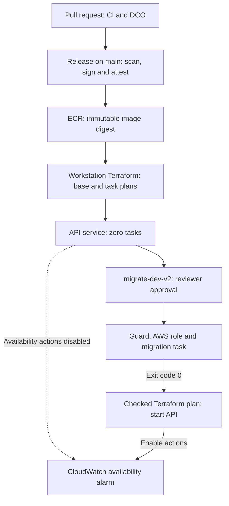
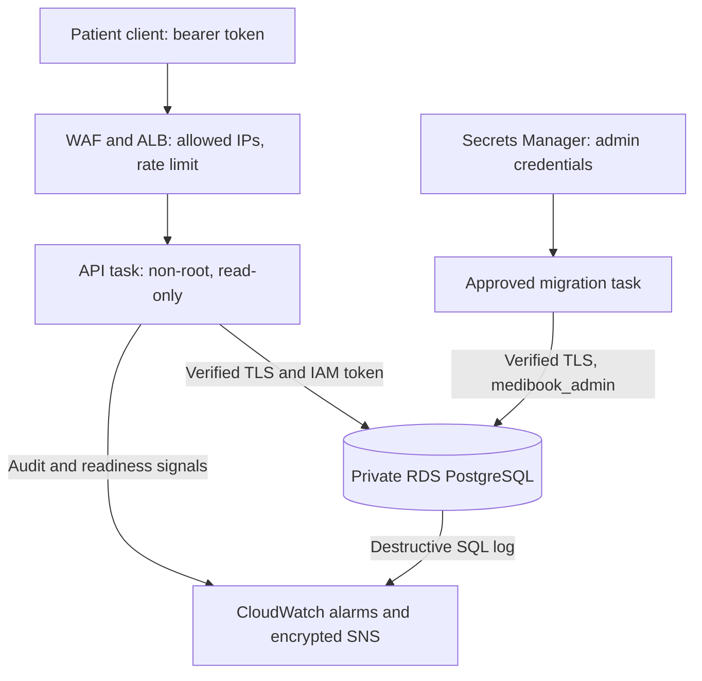

# Architecture walkthrough

MediBook is a portfolio API using synthetic data. Terraform deployment plans verify that an image was signed by the release workflow on `main`. Direct AWS API or console deployments can bypass that check; the dev environment is not a production deployment.

The diagram shows the production target. The implemented dev environment and its remaining gaps are described below.

## Delivery path

1. **Pull request.** CI runs PostgreSQL tests, SAST, dependency and secret scans, image scanning, policy tests, authenticated DAST and a Terraform plan of both stacks. DCO checks commit sign-off; GitHub also supplies CodeQL checks. [PR #46](https://github.com/abdurahim50/medibook/pull/46) completed 12 successful checks.
2. **Release.** A code or infrastructure merge to `main` runs [`release.yml`](../.github/workflows/release.yml), using short-lived GitHub OIDC credentials to publish a Trivy-scanned image, a CycloneDX SBOM and Cosign keyless signatures. Documentation-only merges do not publish a new image; the workflow can also be dispatched manually.
3. **Plan and apply.** Workstation Terraform verifies the signature and SBOM attestation using [`verify-image-terraform.sh`](../scripts/verify-image-terraform.sh). Task definitions require a verified digest; MB-POL-09 checks that the verification step is present. Ten [policy rules](../policy/terraform/) check each saved plan before apply, including rollback and teardown.
4. **Migrate before serving patients.** A fresh session creates the base infrastructure, then signed task definitions and an API service with zero tasks. The [`migrate.yml`](../.github/workflows/migrate.yml) job waits for `migrate-dev-v2` approval. Its guard checks reviewers, administrator bypass, branch restrictions and whether the workflow revision is still main's head before requesting AWS credentials. Only a successful migration is followed by a plan to start the API.

The migration AWS role trusts the exact v2 environment subject, excluding historical runs in `migrate-dev`. Trust remains environment-scoped, not workflow-scoped. Environment administrators are trusted. The role can start the migration task in the dev cluster and pass its execution role; IAM does not restrict ECS command overrides.

## Request path

| Hop | Accepts traffic only from | Protection |
| --- | --- | --- |
| Load balancer | Allowed client IPs | WAF rate limits sign-in and sign-up; known-bad-input rules; invalid headers dropped |
| API task | The load balancer's security group | Non-root, read-only filesystem, capabilities dropped; task role limited to `rds-db:connect` as `medibook_app` |
| Database | The shared API/migration task security group | Private subnets, KMS encryption, enforced and verified TLS, seven-day point-in-time recovery |

Sessions identify the patient, and appointment queries enforce ownership. The API connects as `medibook_app`, with row access only and no database password. RDS generates the admin credentials and stores them in Secrets Manager; only the migration execution role can read them in the routine path.

`/health` checks process liveness and is used by the ALB. `/ready` and the scheduled probe check the database. Startup grace defaults to zero; exceptional grace requires a fixed UTC deadline. Database connection failures on patient endpoints return a generic `503` with `Retry-After: 60`. Four alarms cover denied requests, no healthy targets, destructive SQL and database connectivity.

## Dev environment versus production

| Area | Dev in this repository | Production target |
| --- | --- | --- |
| Client to load balancer | HTTP restricted to allowed IPs | HTTPS with an ACM certificate |
| API tasks | One task in public subnets; inbound from ALB only | Multiple tasks in private subnets with VPC endpoints |
| Database | Single-AZ, deleted at session end | Multi-AZ, deletion protection and final snapshot |
| Deploys | Workstation Terraform with signature and policy checks | Controlled CI deployment identity |
| Migrations | Approval-gated GitHub workflow, v2 environment and dedicated AWS role | Independent reviewer, no self-review, separate administrator boundary |
| Availability detection | Filled healthy-host metric, 2 of 3 periods; one drill alarmed after 4 min 3 s from scaling request | Additional availability signals with an explicit operational objective |
| Logs and alerts | Seven-day retention; confirmed email subscription | Separate protected log account, longer retention and paging |

The [round 6 session](evidence/deployment/aws-verification-2026-10-14-round6.md) verified the migration sequence, healthy API, alarm delivery, a total outage and recovery. The dev stack was destroyed afterward. Open gaps are in [controls.md](controls.md); historical results are indexed in [evidence.md](evidence.md).
